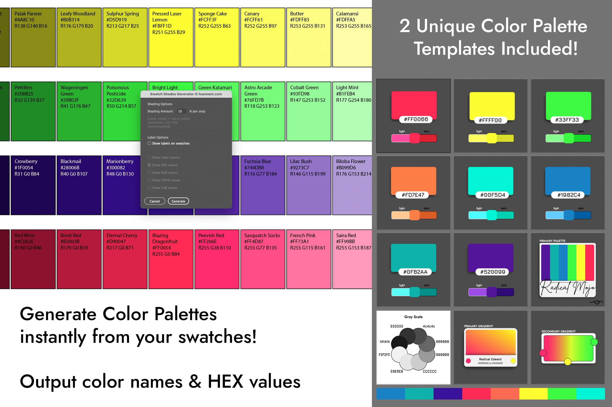

# AI Swatch Scripts - FREE Version

**A Huement Original**

Professional color workflow tools for Adobe Illustrator.


---

## 🎁 FREE Version - What's Included

This is the **FREE version** of AI Swatch Scripts, giving you a taste of professional color workflow automation:

### ✅ Included in FREE Version:
- **Swatch Legend** - Generate professional color legend grids
- **Palette Template V2** - Extended palette with gradients

---

## 🚀 Want More? Get the Full Version!

The **complete AI Swatch Scripts package** includes all the professional tools you need:

[](https://huementsoftware.gumroad.com/l/aiscripts)

### 🎨 Full Version Includes:

#### All 4 Professional Scripts:
- ✅ **Swatch Legend** - Color legend grids with HEX, RGB, CMYK, LAB values
- ✅ **Swatch Shades** - Generate tints and shades automatically
- ✅ **Swatch Export** - Export to JSON, SCSS, LESS, CSS Variables
- ✅ **Swatch Transfer** - Transfer swatches between documents

#### Both Professional Templates:
- ✅ **Palette V1** - Classic Bootstrap color palette
- ✅ **Palette V2** - Extended palette with gradients

#### Advanced Features:
- 27,000+ color names database
- Multiple export formats (JSON, SCSS, LESS, CSS)
- Batch processing and automation
- Professional documentation and support

### 💰 Name Your Price - Starting at $3+

**[Get the Full Version on Gumroad →](https://huementsoftware.gumroad.com/l/aiscripts)**

Compatible with Adobe Illustrator CC 2019 and later (macOS and Windows)

---

## 📦 Installation - FREE Version

### macOS

1. Navigate to your Adobe Illustrator Scripts folder:
   ```
   /Applications/Adobe Illustrator [VERSION]/Presets/[LANGUAGE]/Scripts/
   ```
   Example: `/Applications/Adobe Illustrator 2024/Presets/en_US/Scripts/`

2. Copy these files from the `Scripts/` folder:
   - `SwatchLegend.jsx`
   - `colornames.min.json` ⚠️ **Required for color naming feature**

3. Restart Adobe Illustrator

**Alternative:** You can also use the user Scripts folder:
```
~/Library/Application Support/Adobe/Adobe Illustrator [VERSION]/[LANGUAGE]/Scripts/
```

### Windows

1. Navigate to your Adobe Illustrator Scripts folder:
   ```
   C:\Program Files\Adobe\Adobe Illustrator [VERSION]\Presets\[LANGUAGE]\Scripts\
   ```
   Example: `C:\Program Files\Adobe\Adobe Illustrator 2024\Presets\en_US\Scripts\`

2. Copy these files from the `Scripts/` folder:
   - `SwatchLegend.jsx`
   - `colornames.min.json` ⚠️ **Required for color naming feature**

3. Restart Adobe Illustrator

**Alternative:** You can also use:
```
C:\Users\[USERNAME]\AppData\Roaming\Adobe\Adobe Illustrator [VERSION]\[LANGUAGE]\Scripts\
```

⚠️ **Important:** The `colornames.min.json` file must be in the same folder as the script.

---

## 🚀 Using Swatch Legend (FREE Version)

### Swatch Legend

Generate professional color legend grids with detailed color information.

**Features:**
- Display HEX, RGB, CMYK, and LAB values
- Automatic color naming using 27,000+ color names
- Sort colors by hue automatically
- Customizable borders and layouts
- Perfect for style guides and documentation

**How to Use:**
1. Select swatches in the Swatches panel (or none for all swatches)
2. Run **File → Scripts → SwatchLegend**
3. Choose display options in the dialog (HEX, RGB, CMYK, etc.)
4. Click Generate

**Result:** A grid of color squares with detailed information for each color.

**Example Output Format:**
```
[Swatch Name]
HEX #RRGGBB
R [0-255] G [0-255] B [0-255]
C [0-100] M [0-100] Y [0-100] K [0-100]
```

---

## 📋 Palette Template V2 (FREE Version)

The included template file provides a professional starting point:

- Bootstrap-compatible colors
- Hover state variations
- Complete grayscale palette
- Pre-built gradient swatches

**How to Use:**
1. Open `Templates/palette-v2.ai` in Illustrator
2. Use the colors directly or copy swatches to your projects
3. Customize as needed for your design system

---

## 🔓 Unlock All Features

### What You're Missing in the FREE Version:

❌ **Swatch Shades** - Generate 5 lighter + 5 darker variations automatically  
❌ **Swatch Export** - Export to JSON, SCSS, LESS, CSS Variables, CSS Classes  
❌ **Swatch Transfer** - Copy swatches between documents with batch support  
❌ **Palette Template V1** - Classic Bootstrap palette  

### Upgrade to Full Version:

Get all 4 scripts + 2 templates for professional color workflow automation.

**[Purchase on Gumroad - $3+ →](https://huementsoftware.gumroad.com/l/aiscripts)**

---

## 📖 Documentation

Full installation guide and detailed documentation available at:
[docs/index.html](docs/index.html)

Open the HTML file in your browser for a complete visual guide with screenshots.

---

## 🔧 Compatibility

- **Adobe Illustrator CC 2019** and later
- **macOS** 10.12 Sierra or later
- **Windows** 10 or later

---

## 🐛 Troubleshooting

### Script doesn't appear in the menu
- Restart Illustrator after copying files
- Verify file extension is `.jsx` not `.jsx.txt`
- Check you're using the correct Scripts folder
- Try the alternative user folder location

### Script runs but nothing happens
- Make sure you have an open document with swatches
- Select swatches before running the script
- Check that your layers aren't locked
- Try creating a test document with basic swatches

### Color naming doesn't work
- Verify `colornames.min.json` is in the same folder as the script
- The file must be named exactly `colornames.min.json`

### Colors don't match exactly
Color conversions between different color spaces (RGB, CMYK, LAB) can result in slight variations. This is normal behavior due to different color gamuts.

---

## 💎 Why Upgrade to the Full Version?

### Save Hours of Manual Work
- **Swatch Export** exports to 5+ formats instantly (JSON, SCSS, LESS, CSS)
- **Swatch Shades** creates 11 color variations in seconds
- **Swatch Transfer** moves entire color libraries between documents

### Professional Results
- Minified output for production
- Batch processing support
- Consistent naming conventions
- Developer-ready code

### Complete Package
- 4 powerful scripts working together
- 2 professional templates
- Comprehensive documentation
- Regular updates and support

**[Get the Full Version Now →](https://huementsoftware.gumroad.com/l/aiscripts)**

---

## 📄 License

Copyright © 2025 [Huement.com](https://huement.com) - All Rights Reserved

This FREE version is provided for evaluation and limited use. Licensed users may use this script for personal or commercial projects. Unauthorized copying, distribution, modification, redistribution, or resale of these scripts is strictly prohibited without written permission from Huement.com.

For the complete professional package with all features:  
**[https://huementsoftware.gumroad.com/l/aiscripts](https://huementsoftware.gumroad.com/l/aiscripts)**

For licensing inquiries: [https://huement.com](https://huement.com)

---

## 🙏 Credits

Built with insights from the Adobe Illustrator scripting community.  
Refactored and modernized in 2025.

**Made with ❤️ by Huement**

---

## 🛒 Get the Full Version

Ready to unlock all features?

[](https://huementsoftware.gumroad.com/l/aiscripts)

**Starting at $3+ · Instant Download · No Subscription**
